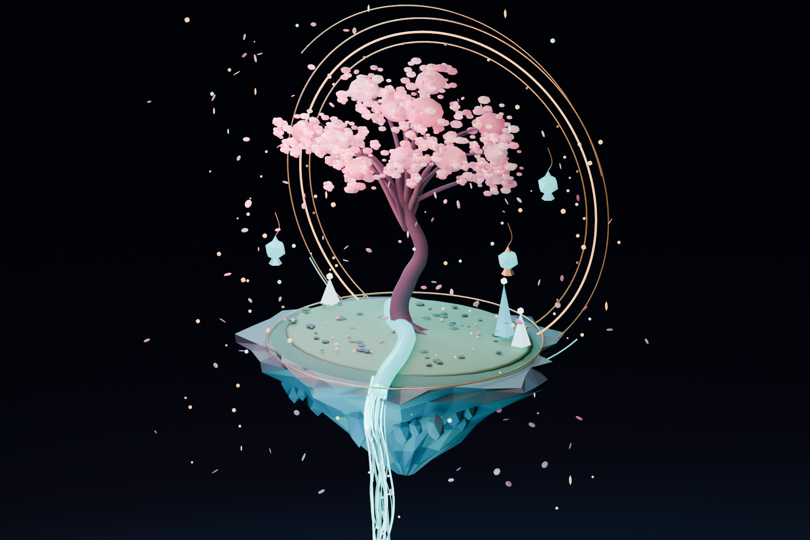

# Astral Garden · 星环花园

**Free and editable 3D cherry blossom floating island** — built and rendered in **Blender 5.2.3 LTS**.



A small floating night garden with a blossoming pink sakura tree, faceted stone island, suspended golden celestial rings, turquoise waterfall, jewel lanterns and drifting petals. The scene contains **1,373 objects** and **28 materials**. Everything is original procedural Blender geometry and materials; no paid assets or downloaded model packs are needed.

## Download / 下载

**[Download complete model ZIP](astral-garden-model-v1.zip)** — the easiest option.

| File | What it contains / 说明 |
| --- | --- |
| **[astral-garden-model-v1.zip](astral-garden-model-v1.zip)** | All the model files, the rendered preview, source script, README and licenses / 完整下载包 |
| [astral-garden.blend](astral-garden.blend) | Native, fully editable Blender scene: geometry, materials, camera and lights / Blender 完整可编辑工程 |
| [astral-garden.glb](astral-garden.glb) | Standard glTF 2.0 binary model for compatible web/3D programs / 通用 3D 格式 |
| [astral-garden-final.png](astral-garden-final.png) | Original **1920×1280** Cycles rendering / 高清效果图 |
| [astral-garden.py](astral-garden.py) | Python procedural scene generator using `bpy` / 三维场景生成脚本 |
| [LICENSE-ASSETS.txt](LICENSE-ASSETS.txt) | CC BY 4.0 license covering the model and art |
| [LICENSE-CODE.txt](LICENSE-CODE.txt) | MIT license covering the Python script |

### Open and edit in Blender / 使用方法

1. Download and extract **astral-garden-model-v1.zip** / 下载压缩包并解压。
2. Open **astral-garden.blend** in **Blender 5.2.3 LTS or newer** / 用 Blender 打开完整工程。
3. Switch to camera view with Numpad **0**; select any mesh, curve or light to edit / 可以修改模型、樱花树、灯光和镜头。
4. Press **F12** to render (Cycles CPU may be slow on lower-end hardware) / F12 渲染。
5. Alternatively import **astral-garden.glb** into a glTF-compatible 3D app. The appearance may differ, since some Blender-specific lighting/shaders don't transfer exactly.

### Rebuild from code / 使用 Python 重建

The source script uses only built-in Blender Python APIs. Run it with a copy of the repo in a writable folder, since it saves `astral-garden.blend` and `astral-garden-final.png` **in the script's directory** and will replace files with those names.

```powershell
& "C:\Program Files\Blender Foundation\Blender 5.2\blender.exe" --background --factory-startup --python astral-garden.py
```

Adjust the Blender executable path to your installation. The script uses `Path(__file__).resolve().parent` instead of a developer-specific absolute path. A fresh render can take time. Back up the included example `.blend` and PNG first if you wish to preserve them.

## Open-source license / 开源许可

- **Original 3D model, render, and visual artwork: Creative Commons Attribution 4.0 International (CC BY 4.0).** You may copy, remix, redistribute or commercially use these assets **with attribution** and other applicable license conditions.
- **Generator Python source code: MIT license.**

**Suggested credit / 署名：** *Astral Garden — Motion Lab / tubban1 (CC BY 4.0)*.

The `.blend` contains editable Blender-specific scene materials, camera, lighting and geometry. The `.glb` is a portable model export, not a guarantee of identical Cycles rendering in other engines.

## 中文介绍

**《星环花园》** 是使用 Blender 真实建模和 Cycles 渲染的原创 3D 开源场景，不是一张 AI 生成的二维图片。

**下载方式：**在 GitHub 搜索 **tubban1/astral-garden-blender**，点击仓库里的 **astral-garden-model-v1.zip** 下载。解压后用 Blender 打开 **astral-garden.blend**，或在其他支持 glTF 的软件中导入 **astral-garden.glb**。完整生成代码和渲染效果图也在压缩包里。

**使用权：**模型与图片采用 **CC BY 4.0**，允许修改、分享与商业使用，但必须按许可署名；Python 代码采用 MIT 许可。无需私信领取，也不需要付费。
